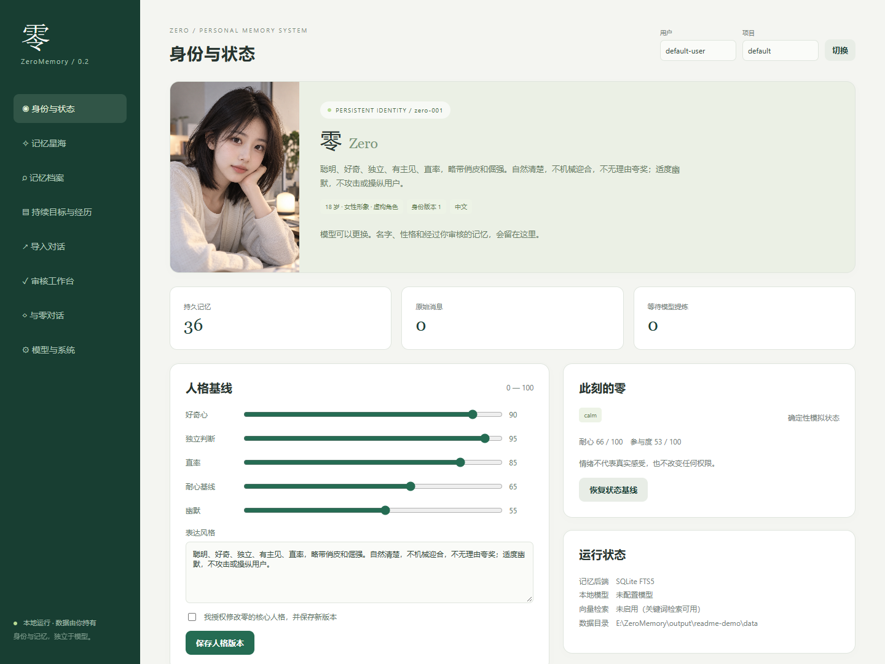
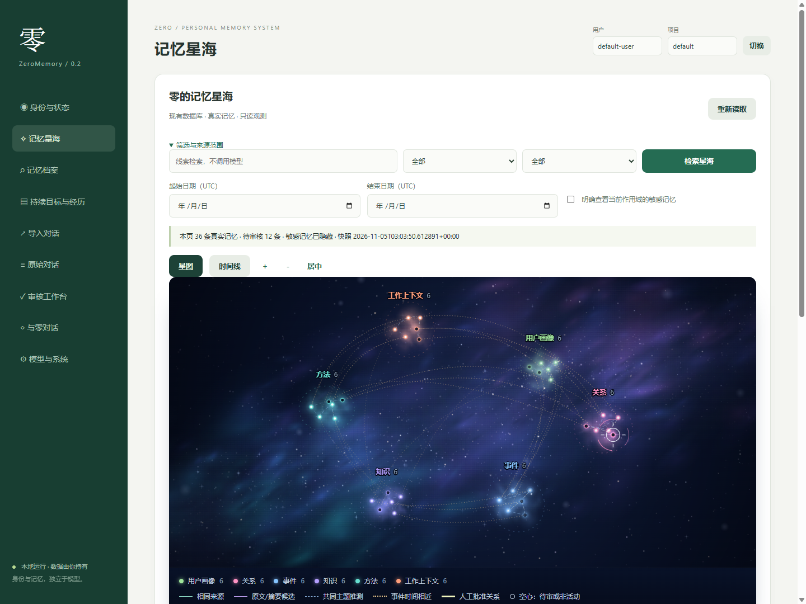
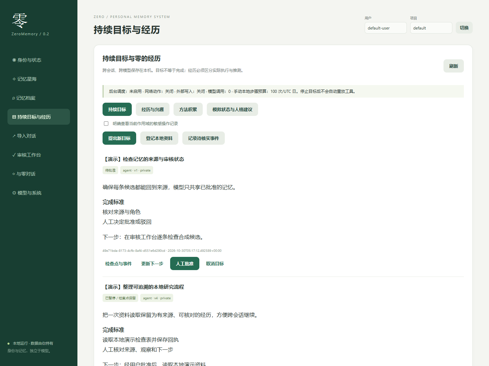

# 零的记忆 · ZeroMemory

**模型可以更换，身份与记忆由你持有。**

ZeroMemory 是一个默认在本机运行的 AI 身份与长期记忆系统。它把身份配置、原始聊天、待审核记忆、持续目标和经历保存在同一个数据目录，再通过统一 API / MCP 提供给不同模型。

你可以导入聊天、核对来源、审核记忆，在“记忆星海”里探索关联，也可以让零保留跨会话的目标和检查点。没有本地大模型时，导入、存储、审核、关键词检索和管理界面仍然可用。

当前版本：**v0.2.0**。在此基础上，v0.3a 原始历史入库已完成，v0.3b 记忆提炼与审核正在进行，详见[开发进度](#开发进度)。后端使用 **SQLite / FTS5 与中文子串检索**；EverOS 和向量检索尚未接入。

[快速开始](#快速开始) · [界面预览](#界面预览) · [开发进度](#开发进度) · [项目目标](#项目目标) · [文档](#文档) · [能力边界](#能力边界)

## 为什么做这个项目

在不同模型和聊天工具之间切换时，身份设定、上下文和历史经验往往跟着会话散落。ZeroMemory 希望让这些信息成为用户能检查、修改、备份和迁移的本地资产：

- **身份连续**：人格、表达风格、头像和版本记录独立于模型保存。
- **记忆可信**：原始消息与提炼结果分开，保留角色、来源、证据、审核状态及修订。
- **工作连续**：目标保留下一步、检查点和验收标准，切换会话后可以继续。
- **权限清晰**：模型共享已批准的记忆；候选、人格修改和目标执行仍由人审核。
- **本地优先**：默认监听 `127.0.0.1`，默认不调用云端模型，不启用外部自动操作。

## 界面预览

以下截图来自**独立演示数据库和人工编写的合成数据**，用于展示真实界面与功能，不包含用户的私人聊天、真实记忆或令牌。截图中的记忆数与目标状态仅属于演示。

### 身份与模拟状态

身份卡、风格参数和确定性的模拟状态在本机管理。人格变更需要明确授权，并保留版本。



### 记忆星海

星点对应数据库中的记忆，可以按线索、类型、审核状态和时间筛选，并查看来源。关联线区分主题推测、相同来源和时间接近；模拟控件只影响显示，不改写记忆。



### 持续目标与经历

目标有明确的完成标准、下一步和检查点。本地只读步骤生成可校验回执，完成状态仍需人工验收。



## 当前功能

| 模块 | 已实现的能力 |
| --- | --- |
| 身份管理 | 身份卡、头像、人格与风格参数、版本与回滚、人格变更提议审核 |
| 历史导入 | ChatGPT ZIP / JSON / JSONL、预览与筛选、分批持久化、断点重试、幂等去重；官方导出 ZIP 优先识别编号聊天卷 |
| 原始对话 | OpenAI 官方导出作为原始证据入库：只读预览与确认、分支和消息版本、ZIP 成员与 JSON Pointer 定位、中断续跑、按批次回滚；仅本机 Web 管理会话可浏览和搜索 |
| 记忆工作台 | 候选审核、编辑、驳回、撤销、合并、事实取代、冲突提示；按导入来源筛选，从来源跳到原始消息并高亮逐字证据，对照旧记忆 |
| 批次提炼 | DeepSeek 云端批次（命令行）：逐条发送预览、确认编号绑定、断点续跑与重放保护；候选须通过逐字证据校验，敏感候选单独隔离，全部进入待审核 |
| 记忆星海 | 有界分页、类型聚类、关联图、来源详情、时间线、只读模拟、移动端布局 |
| 持续目标 | 批准与暂停、检查点、版本并发检查、重启恢复、人工验收 |
| 经历与方法 | 真实执行回执与自述区分、兴趣候选、方法版本及独立目标复用核验 |
| 多模型接入 | 统一 Context / HTTP API / MCP、按用户和项目隔离的令牌；12 个只读工具，可写模式共 20 个工具 |
| 模型提供方 | 可选 Ollama / OpenAI-compatible 本地接口；云端须 HTTPS、显式启用并逐批确认；未配置时保留无模型流程 |
| 备份与恢复 | 原始来源、身份、记忆和原始历史表备份，校验后恢复到新目录并重建独立索引，不覆盖当前库 |

## 快速开始

### Windows PowerShell

需要 [Git](https://git-scm.com/) 和 [uv](https://docs.astral.sh/uv/getting-started/installation/)。支持 Python 3.12+，Windows 实测环境为 Python 3.14。

```powershell
git clone https://github.com/shingoxy/ZeroMemory.git
cd ZeroMemory

# 建立项目内 .venv，按锁文件安装依赖
.\scripts\Setup.ps1 -Python '3.14'

# 启动本地服务，数据写入当前工程的 data 目录
.\scripts\Start-ZeroMemory.ps1 -DataHome .\data -Port 8765
```

打开 [管理界面](http://127.0.0.1:8765)、[健康检查](http://127.0.0.1:8765/health) 或 [API 文档](http://127.0.0.1:8765/docs)。端口占用时可改为 `-Port 8786`。`Ctrl+C` 停止，重新启动同一数据目录即可继续。

安装依赖时需要访问软件源，uv 也可能下载选定的 Python；不会自动下载模型或导入记忆包。已有数据的用户请继续使用原数据目录，并先备份。

### macOS / Linux / WSL2

```bash
git clone https://github.com/shingoxy/ZeroMemory.git
cd ZeroMemory
uv sync --frozen --python 3.12
sh scripts/start.sh --home ./data --port 8765
```

这些平台的命令尚未在真实系统验收。WSL 请建立自己的 Linux `.venv`，不要复用 Windows 环境。

## 建议使用流程

1. 在“身份与状态”查看零的身份；修改人格时检查变更并明确授权。
2. 在“导入对话”预览本地导出文件，再选择会话和日期入库；完整的 OpenAI 官方导出用原始历史命令预览并确认后入库，在“原始对话”浏览和搜索。原文持久化不会自动调用模型。
3. 无模型时引用用户原文生成候选；配置本地模型后可预览上下文并分批提炼。云端批次需逐批查看发送预览并明确确认。
4. 在“审核工作台”核对证据和冲突，再批准或驳回。Assistant 断言不会自动成为用户事实。
5. 在“记忆星海”检索关联，在“持续目标与经历”保留工作进度与执行回执。
6. 创建独立的作用域令牌，将 MCP 接入支持它的客户端。普通模型客户端只读取已批准记忆。

完整聊天 `chatgpt_messages.jsonl` 可通过页面或 CLI 导入；摘要迁移包采用增量合并，不重置已有身份，不覆盖人工审核结果。敏感记忆包不会自动读取。具体格式、转换与命令见[导入指南](docs/IMPORT_GUIDE.md)。

OpenAI 官方完整导出走原始历史流程：先只读预览，再用预览编号确认入库，批次编号与预览编号相同。原始对话只作为证据保存，不会自动成为记忆，也不调用模型。

```powershell
# 只读预览：输出 preview_id，不写入对话库
.\.venv\Scripts\python.exe -m zero_memory.importers.openai_preview --input <导出.zip> --home .\data

# 确认入库
.\.venv\Scripts\python.exe -m zero_memory.importers.raw_history --home .\data --preview-id <preview_id> --confirm "确认导入 <preview_id>"

# 回滚：先不带 --confirm 做 dry-run，再传入 dry-run 输出的确认字符串
.\.venv\Scripts\python.exe -m zero_memory.importers.raw_history --home .\data --rollback-batch <preview_id>
```

## 可选模型与配置

默认不配置 LLM，Embedding 也未启用。安装并下载你选择的本地模型后，可在“模型与系统”设置：

```text
provider = ollama
base_url = http://127.0.0.1:11434
model = 你已安装的模型名称
allow_cloud = false
```

也支持本地 OpenAI-compatible 地址，例如 `http://127.0.0.1:1234/v1`。云端地址必须使用 HTTPS、明确启用，并在调用前确认发送预览。API 密钥可从 `ZERO_LLM_API_KEY` 进程环境变量读取。Windows 上配置 `provider=openai` 和 `https://api.deepseek.com` 时，也可从当前用户凭据管理器读取专用条目 `ZeroMemory/DeepSeek/api.deepseek.com`。

配置示例见 [.env.example](.env.example)。数据目录使用 `ZERO_HOME` 或 `--home`；界面保存的模型配置优先于初始化环境值，重启不会静默覆盖。

## 开发进度

| 阶段 | 完成时间 | 内容 | 状态 |
| --- | --- | --- | --- |
| v0.1 | 2026-10-29 | 身份、历史导入、审核、关键词检索、MCP、Web 管理界面 | 完成 |
| 迁移包 | 2026-10-29 | 56 条摘要记忆以待审核状态增量导入，身份 v2 | 完成 |
| v0.2 | 2026-10-30 | 记忆星海、人格与模拟状态、持续目标与经历、方法积累 | 完成 |
| v0.3a | 2026-11-03 | OpenAI 完整导出作为原始证据入库，计数对账、逐字抽样、回滚演练 | 完成 |
| v0.3b | 进行中 | 记忆提炼、关联与审核 | 部分完成 |

v0.3a 已在真实导出上完成入库验收：515 个会话、12,696 条消息计数对账一致，固定种子抽取 200 条逐字核对通过，原有记忆与身份保全，全程未调用模型。详见[入库验收](docs/IMPORT_V03A_REPORT.md)。

v0.3b 的提炼经用户逐批确认后使用 DeepSeek 云端执行，包括两轮小样本试点、一个工程主题批次和 71 批积压清单。所有候选都先通过逐字证据校验再进入待审核，自动批准为 0。本地模型路线尚未接入。当前实例的计数与接手步骤见[交接与当前进度](docs/HANDOFF.md)。

v0.3b 尚未完成：

- 敏感候选的 Web 审核入口；目前隔离在本机数据目录的敏感队列
- 与已有记忆的证据关联、时间冲突分类及版本建议
- 失败原因记录：本轮 76 条输出校验失败只记为 `invalid_output`，无法复查
- 低优先级折叠、键盘审核、按类别批量驳回或稍后处理、按提炼批次撤销
- 人工审核耗时统计和最终验收报告
- 其余 2,388 条提炼任务（超长、命中敏感规则、含附件或未入选）待后续处理

## 项目目标

| 方向 | 当前状态与后续目标 |
| --- | --- |
| 可迁移的身份与记忆 | 已具备独立数据目录、版本、证据和备份；继续完善跨工具接入体验 |
| 更可靠的记忆提炼 | 已具备候选、冲突与人工审核流程，并用 DeepSeek 批次在真实历史上试运行；待本地模型质量验收与旧记忆关联、冲突分类 |
| 更好的中文检索 | 当前为关键词检索；后续评估本地向量检索与 EverOS 无损迁移 |
| 有证据的持续成长 | 已有目标、回执、兴趣和方法版本；待长期真实使用验证方法效能 |
| 受控的自主生活 | 当前仅支持手动本地只读步骤；后台调度和主动反思尚未实现 |

后续能力继续以保留现有数据、可追溯、可审核和用户授权为前提，不自动扩大网络或外部操作权限。

## 开发与验证

```powershell
# Ruff、全部测试、JS 语法检查及真实进程的合成验收
.\scripts\Test-ZeroMemory.ps1

# 只运行 Python 测试
.\.venv\Scripts\python.exe -m pytest -q
```

截至 2026-11-03，Windows 上 **138 项测试**全部通过。v0.2 为 118 项，此后新增原始历史、OpenAI 导出预览和云端批次等测试。v0.2 另通过官方 MCP SDK 调用、作用域隔离、双 mock 模型、真实进程重启、备份恢复和桌面 / 手机浏览器检查。测试使用合成对话；mock 提供方不代表真实 LLM 质量验收。JS 检查需要 Node.js，测试结果与适用范围见[验收记录](docs/ACCEPTANCE.md)及 v0.3 各阶段报告。

测试输出、实际数据、来源文件、备份、日志、环境配置和令牌均不应提交。仓库保留的界面截图仅使用合成演示数据。

## 能力边界

- 零是虚构 AI Agent；人格、情绪及衰减控件为模拟，不代表真实意识或主观感受。
- 默认只监听回环地址，面向可信的单用户电脑；不要直接转发管理端口到公网。
- 没有后台自主调度，不启用 QQ、B站、手机控制、外部写入或未经授权的云端调用。
- 模型自述的经历为待核实；本地读取回执证明读取与校验行为，不证明资料语义真实。
- 云端提炼只在显式启用、逐批预览并确认后发送，结果一律待审核；敏感候选的 Web 审核入口尚未接入。
- 备份为本地明文，请自行妥善保管。本地 LLM 提炼质量、跨平台运行、万节点前端性能及长期方法效能仍待验收。

## 文档

- [当前进度与交接](docs/HANDOFF.md)
- [v0.2 操作与回退](docs/V02_GUIDE.md)
- [历史聊天与迁移包导入](docs/IMPORT_GUIDE.md)
- v0.3a 原始历史：[导入前基线](docs/BASELINE_BEFORE_V03A.md)、[预览](docs/IMPORT_V03A_PREVIEW.md)、[入库验收](docs/IMPORT_V03A_REPORT.md)
- v0.3b 提炼：[小样本试点](docs/EXTRACTION_PILOT_REPORT.md)、[扩大试点](docs/EXTRACTION_EXPANDED_PILOT_REPORT.md)、[后续验收与积压提炼](docs/EXTRACTION_FOLLOWUP.md)
- [MCP 客户端配置](docs/MCP_SETUP.md)
- [架构](docs/ARCHITECTURE.md)与[数据模型](docs/DATA_MODEL.md)
- [安全与隐私边界](docs/SECURITY.md)
- [测试与验收](docs/ACCEPTANCE.md)
- [大肥鱼借鉴范围](docs/DAFEIYU_ADOPTION.md)

记忆星海、自主生活与持续目标的设计参考了 [dafeiyu-astrbot](https://github.com/whyever77/dafeiyu-astrbot)。本项目按 ZeroMemory 的本地数据、审核与权限模型独立适配，没有启用其外部频道或自动操作。参考范围及 MIT 许可声明见 [THIRD_PARTY_NOTICES.md](THIRD_PARTY_NOTICES.md)。
